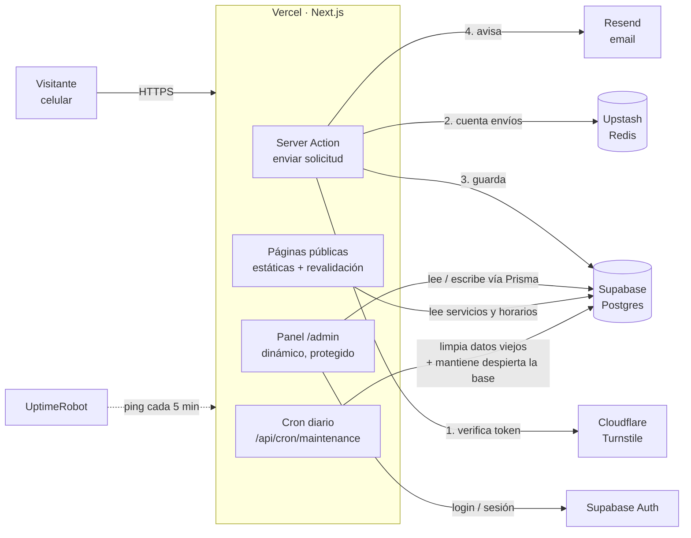
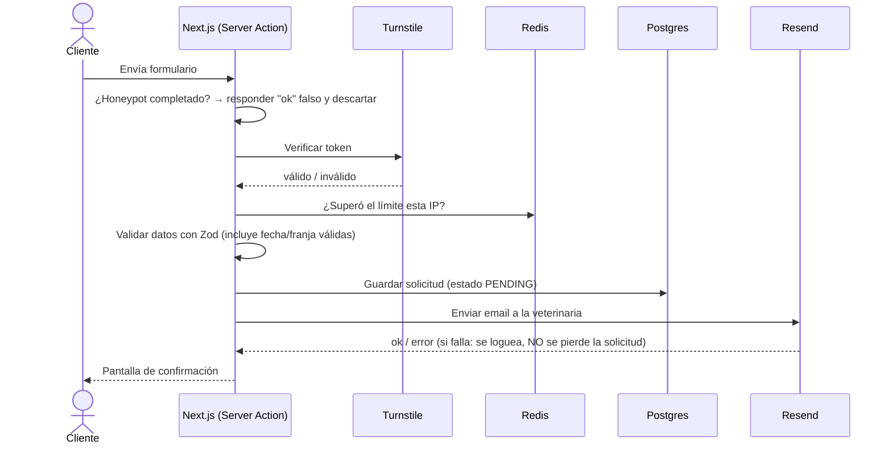

# 02 · Arquitectura

> **Qué es este documento:** el "plano" del sistema. Qué piezas hay, cómo se comunican y dónde va cada cosa en el código.

---

## 1. Vista general



**En palabras simples:**

- **Vercel** es la computadora en internet donde vive el sitio. Ejecuta **Next.js**, que arma tanto las páginas como la lógica del servidor.
- **Supabase** nos da dos cosas: una base de datos **Postgres** (donde se guardan servicios, horarios, solicitudes y usuarios) y **Auth** (el sistema de login).
- **Prisma** es el "traductor" entre nuestro código TypeScript y la base de datos: escribimos `prisma.service.findMany()` en vez de SQL a mano, y TypeScript nos avisa si nos equivocamos de campo.
- **Upstash Redis** es una memoria rápida donde anotamos "esta IP ya mandó 3 solicitudes" con vencimiento automático.
- **Turnstile** (Cloudflare) es un CAPTCHA casi invisible que distingue humanos de bots.
- **Resend** envía el email a la veterinaria.
- **UptimeRobot** visita el sitio cada 5 minutos y te avisa si está caído.

---

## 2. Estrategia de renderizado (clave para Lighthouse ≥ 90)

| Zona | Cómo se genera | Por qué |
|---|---|---|
| Páginas públicas (`/`, `/servicios`, `/nosotros`, `/contacto`, `/privacidad`) | **Estáticas**: se generan una vez y se sirven ya armadas desde la red de Vercel. | Velocidad máxima: el servidor no hace nada por cada visita. |
| Cuando Laura cambia un precio u horario | **Revalidación bajo demanda**: la acción de guardar le dice a Next.js "regenerá `/servicios`". | Los cambios se ven en segundos sin perder la velocidad de lo estático. |
| `/turnos` (formulario) | Estática; el envío lo procesa un **Server Action**. | La página carga rápido; la lógica corre solo al enviar. |
| `/admin/**` | **Dinámico** (se genera en cada pedido). | Datos privados y que cambian todo el tiempo; nunca se cachea. |

---

## 3. Flujos principales

### 3.1 Enviar solicitud de turno



Orden pensado: **primero lo más barato** (honeypot) y lo que más spam frena, **después** lo que consume recursos (base, email).

### 3.2 Acción en el panel (ej. cambiar estado)

Todo Server Action del panel sigue **siempre** estos pasos, en este orden:

1. **¿Quién sos?** → obtener usuario de la sesión (Supabase Auth, validado en servidor).
2. **¿Estás activo?** → buscar su `StaffUser` en la base; si no existe o está inactivo, rechazar.
3. **¿Podés hacer esto?** → `can(user, "request:changeStatus", recurso)` (mapa central de permisos).
4. **¿Los datos son válidos?** → validar con Zod.
5. **Hacer la operación** + registrar en el **historial** (en la misma transacción).
6. **Revalidar** las páginas afectadas.

> Por qué no alcanza con proteger `/admin` en el *proxy/middleware*: un Server Action es una dirección pública a la que cualquiera puede mandarle un pedido. La protección de rutas es **comodidad** (redirigir al login); la seguridad real está en los pasos 1–3 de cada acción.

### 3.3 Cron diario de mantenimiento

Vercel llama una vez por día a `/api/cron/maintenance` (protegido con `CRON_SECRET`):

1. Borra solicitudes en estado final (`ATTENDED`/`CANCELLED`) con más de 12 meses.
2. Al hacer una consulta, **mantiene activa la base** (Supabase gratis se pausa con 7 días sin uso).

---

## 4. Estructura de carpetas

Organizada **por funcionalidad** (*feature-based*): todo lo de "solicitudes" está junto, en vez de desparramado por tipo de archivo.

```
veterinaria-huellitas/
├── CLAUDE.md                 ← reglas para la IA
├── README.md                 ← entrada para cualquier persona
├── .env.example              ← variables de entorno necesarias (sin valores reales)
├── docs/                     ← specs (este documento y los demás)
├── prisma/
│   ├── schema.prisma         ← definición de tablas
│   ├── migrations/           ← historial de cambios de la base (incluye SQL de RLS)
│   └── seed.ts               ← datos iniciales de demo
├── public/                   ← imágenes, favicon
├── src/
│   ├── app/                  ← RUTAS (cada carpeta = una URL)
│   │   ├── (public)/         ← sitio público (el paréntesis agrupa sin afectar la URL)
│   │   │   ├── page.tsx              → /
│   │   │   ├── servicios/            → /servicios
│   │   │   ├── nosotros/             → /nosotros
│   │   │   ├── contacto/             → /contacto
│   │   │   ├── turnos/               → /turnos (formulario)
│   │   │   └── privacidad/           → /privacidad
│   │   ├── admin/
│   │   │   ├── login/
│   │   │   ├── (protected)/          ← layout que exige sesión
│   │   │   │   ├── solicitudes/
│   │   │   │   ├── servicios/
│   │   │   │   ├── horarios/
│   │   │   │   └── usuarios/
│   │   ├── api/cron/maintenance/route.ts
│   │   ├── sitemap.ts · robots.ts · layout.tsx · not-found.tsx
│   ├── features/             ← LÓGICA DE NEGOCIO por funcionalidad
│   │   ├── appointment-requests/   (schema.ts, actions.ts, queries.ts, status.ts, components/)
│   │   ├── services/
│   │   ├── schedule/               (horarios, días especiales, validación de fechas)
│   │   └── staff/                  (usuarios del panel)
│   ├── components/
│   │   ├── ui/               ← componentes de shadcn/ui (botones, inputs…)
│   │   └── layout/           ← header, footer, skip link
│   ├── lib/                  ← infraestructura compartida
│   │   ├── db.ts             ← cliente Prisma único
│   │   ├── env.ts            ← valida variables de entorno al arrancar
│   │   ├── auth/             ← clientes Supabase, getCurrentStaff(), permissions.ts
│   │   ├── email/            ← cliente Resend + plantillas
│   │   ├── security/         ← turnstile.ts, rate-limit.ts, honeypot
│   │   ├── seo/              ← JSON-LD, metadatos comunes
│   │   └── dates.ts          ← utilidades de fecha con zona horaria AR
│   └── content/              ← textos estáticos (equipo, propuesta de valor)
├── tests/
│   ├── unit/                 ← Vitest
│   └── e2e/                  ← Playwright
└── .github/workflows/ci.yml  ← verificación automática en cada push
```

**Reglas de dependencia** (qué puede importar qué):

- `app/` importa de `features/`, `components/` y `lib/`.
- `features/X` puede importar de `lib/` y `components/`, **no** de otra feature directamente (si dos features comparten algo, se sube a `lib/`).
- Todo archivo que toque la base, secretos o la sesión empieza con `import "server-only"` → si alguien lo importa por error desde el navegador, **el build falla**.

---

## 5. Entornos

| Entorno | Dónde | Base de datos | Emails | Turnstile |
|---|---|---|---|---|
| Local | Tu PC (`npm run dev`) | Proyecto Supabase **dev** | Resend (a tu casilla) | Claves de prueba de Cloudflare |
| Preview | Vercel, cada rama/PR | Proyecto Supabase **dev** | Resend (a tu casilla) | Claves de prueba |
| Producción | Vercel, rama `main` | Proyecto Supabase **prod** | Resend (a tu casilla hasta tener dominio) | Claves reales |

> Supabase gratis permite 2 proyectos activos → justo uno para dev y uno para prod.

---

## 6. Preparado para multi-sucursal

- Toda entidad del negocio (`Service`, `ScheduleSlot`, `SpecialDay`, `AppointmentRequest`, `StaffUser`) tiene `locationId`.
- Los datos de contacto (dirección, teléfono, WhatsApp, email de avisos, coordenadas) viven en `Location`, no en el código.
- Hoy la app usa "la sucursal por defecto" (`slug = "villa-urquiza"`) desde un único lugar (`getDefaultLocation()`).
- **Cuando llegue la segunda sucursal**: cargar una fila en `Location`, agregar un selector de sucursal en el formulario y un filtro en el panel, y generar páginas `/sucursales/[slug]`. Nada del modelo se reescribe.
