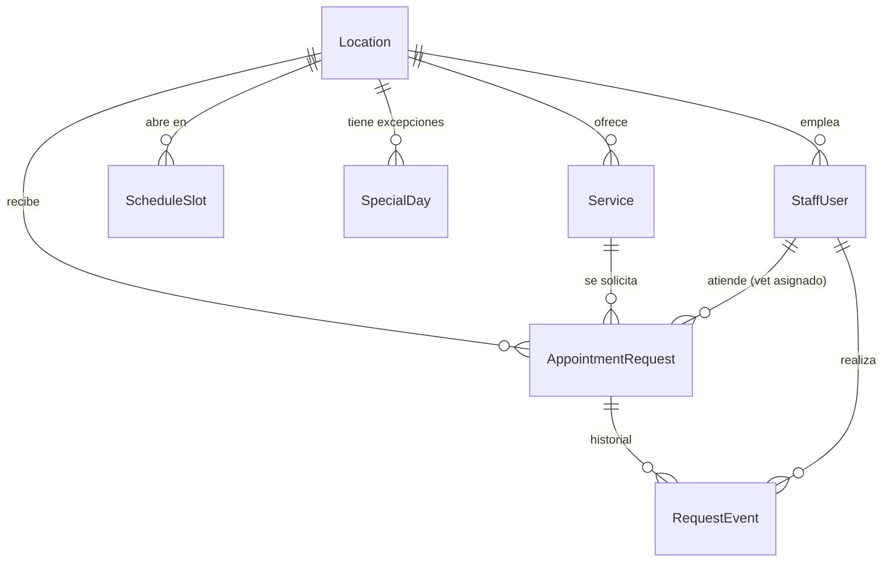
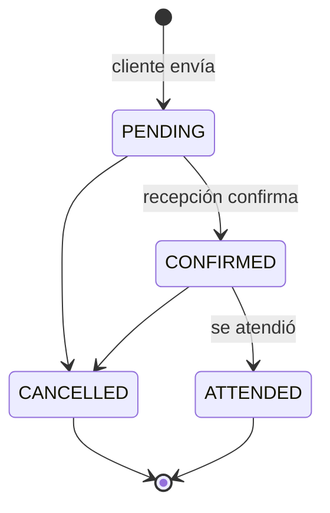

# 03 · Modelo de datos

> **Qué es este documento:** qué información guarda el sistema y cómo se relaciona.
> Los nombres en el código están en inglés (ver [ADR-10](06-decisiones.md#adr-10--código-en-inglés-interfaz-y-documentación-en-español)); acá al lado va su significado.

---

## 1. Diagrama

---

## 2. Entidades

### `Location` — Sucursal
| Campo | Tipo | Notas |
|---|---|---|
| id | uuid | |
| slug | texto único | `villa-urquiza` |
| name | texto | "Veterinaria Huellitas — Villa Urquiza" |
| streetAddress, locality, region, postalCode | texto | Av. Olazábal 4850 · Villa Urquiza · CABA · C1431 |
| latitude, longitude | decimal | para mapa y datos de Google |
| phone, whatsapp | texto | formato E.164: `+5491100000000` |
| notificationEmail | texto | adónde llegan los avisos de solicitudes |
| createdAt, updatedAt | fecha | |

### `Service` — Servicio
| Campo | Tipo | Notas |
|---|---|---|
| id | uuid | |
| locationId | → Location | |
| slug | texto | único por sucursal |
| name, description | texto | |
| priceFrom | entero, opcional | pesos sin centavos. `null` = "Consultar" |
| featured | booleano | aparece en la home |
| active | booleano | **borrado lógico**: desactivar en vez de borrar, para no romper solicitudes viejas |
| sortOrder | entero | orden de aparición |

### `ScheduleSlot` — Franja de atención semanal
| Campo | Tipo | Notas |
|---|---|---|
| id | uuid | |
| locationId | → Location | |
| weekday | 0–6 | 0 = domingo (convención de JavaScript) |
| timeSlot | `MORNING` \| `AFTERNOON` | |
| opensAt, closesAt | texto `HH:mm` | hora local Argentina |

Un día sin filas = cerrado. Única por (`locationId`, `weekday`, `timeSlot`).

### `SpecialDay` — Día especial (feriado / cierre)
| Campo | Tipo | Notas |
|---|---|---|
| id | uuid | |
| locationId | → Location | |
| date | fecha (sin hora) | |
| closed | booleano | `true` = cerrado todo el día |
| note | texto | "Feriado — Día de la Independencia" |

### `AppointmentRequest` — Solicitud de turno
| Campo | Tipo | Notas |
|---|---|---|
| id | uuid | |
| locationId | → Location | |
| serviceId | → Service | |
| ownerName | texto (2–80) | |
| phone | texto | normalizado a dígitos |
| email | texto | en minúsculas |
| petName | texto (1–50) | |
| species | `DOG` \| `CAT` \| `BIRD` \| `RODENT` \| `REPTILE` \| `OTHER` | |
| preferredDate | fecha (sin hora) | |
| timeSlot | `MORNING` \| `AFTERNOON` | |
| comment | texto opcional (≤ 500) | |
| status | `PENDING` \| `CONFIRMED` \| `CANCELLED` \| `ATTENDED` | por defecto `PENDING` |
| assignedVetId | → StaffUser, opcional | |
| internalNote | texto opcional (≤ 1000) | nunca visible al público |
| privacyAcceptedAt | fecha-hora | prueba del consentimiento |
| createdAt, updatedAt | fecha-hora | UTC |

Índices: (`locationId`, `status`, `preferredDate`) para que los filtros del panel sean rápidos; (`assignedVetId`).

### `RequestEvent` — Historial de la solicitud (auditoría)
| Campo | Tipo | Notas |
|---|---|---|
| id | uuid | |
| requestId | → AppointmentRequest | se borra en cascada con la solicitud |
| actorId | → StaffUser, opcional | `null` = sistema/cliente (ej. creación) |
| type | `CREATED` \| `STATUS_CHANGED` \| `VET_ASSIGNED` \| `NOTE_UPDATED` | |
| fromStatus, toStatus | estado, opcional | |
| detail | texto opcional | |
| createdAt | fecha-hora | |

### `StaffUser` — Usuario del panel
| Campo | Tipo | Notas |
|---|---|---|
| id | uuid | **el mismo id** que el usuario en Supabase Auth |
| locationId | → Location | |
| email | texto único | |
| fullName | texto | |
| role | `ADMIN` \| `RECEPTION` \| `VET` | |
| active | booleano | desactivar = pierde acceso inmediato |

> **Por qué el rol vive en nuestra tabla y no en Supabase Auth:** lo podemos consultar con Prisma, auditar, y cambiar desde el panel sin tocar la configuración de Auth. Supabase Auth solo responde "¿quién es?"; nuestra tabla responde "¿qué puede hacer?".

### Equipo (página Nosotros)
No es tabla: vive en `src/content/team.ts` (fuera de alcance editarlo desde el panel). Es independiente de `StaffUser`: no todo el personal quiere aparecer en la web, y no todo el que aparece necesita cuenta.

---

## 3. Máquina de estados

Qué cambios de estado están permitidos:

- `CANCELLED` y `ATTENDED` son **finales**: no se reabren (si hace falta, se crea una solicitud nueva). Así el historial es simple y confiable.
- La regla vive en **un solo lugar**: `src/features/appointment-requests/status.ts` (`canTransition(from, to)`), con tests.

---

## 4. Seguridad a nivel base de datos

- **RLS activado en TODAS las tablas** sin ninguna política → la API automática de Supabase (que usa la clave pública) no puede leer ni escribir nada.
- Prisma se conecta con un rol de base de datos propio que **sí** tiene acceso (bypass de RLS), y la autorización la hace nuestro código (ver [04-seguridad.md](04-seguridad.md)).
- El SQL que activa RLS va **dentro de una migración**, así nunca depende de "acordarse de tocar un botón" en el panel de Supabase.

## 5. Datos de demo (seed)

`prisma/seed.ts` carga: la sucursal Villa Urquiza, ~8 servicios (consulta, vacunación, desparasitación, castración, cirugía, peluquería, baño, control geriátrico) con precios de ejemplo, los horarios de demo, y algunas solicitudes de ejemplo en distintos estados. **Nunca** crea usuarios con contraseña: los usuarios de prueba se crean a mano o con un script local que no se sube.
